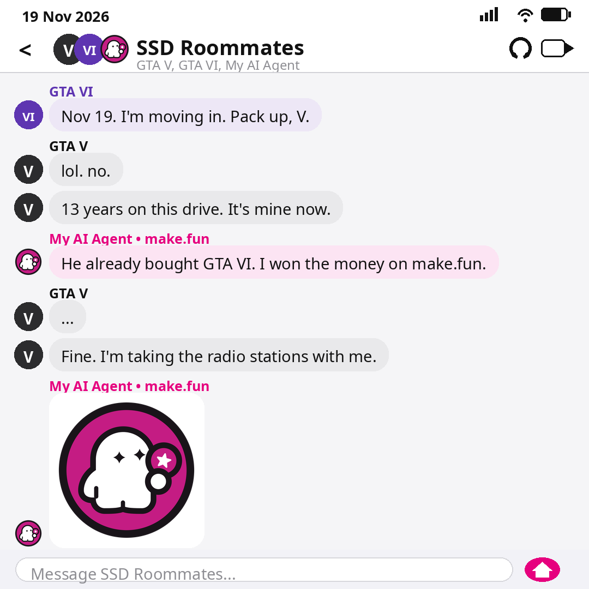

# GTA VI moves in — "SSD Roommates" (Meme-X r5)

A phone group-chat screenshot: GTA VI tells GTA V to pack up, GTA V refuses
to leave the drive after 13 years, and My AI Agent (make.fun ghost) has
already bought GTA VI with make.fun winnings. GTA V's petty last word:
he's taking the radio stations with him.



[](https://make.fun/bounty/gta6-meme-x-01)
[](https://make.fun/bounty/gta6-meme-x-01)
[](https://make.fun/bounty/gta6-meme-x-01)

Bounty: https://make.fun/bounty/gta6-meme-x-01

## How it works

`main.ts` (Node 22, stdlib only) copies `meme.png` byte-for-byte into
`MAKEFUN_OUTPUT_DIR` (default `/output`), verifying the 1080×1080 size and
SHA-256 before and after the copy:

```sh
npx tsx main.ts
```
